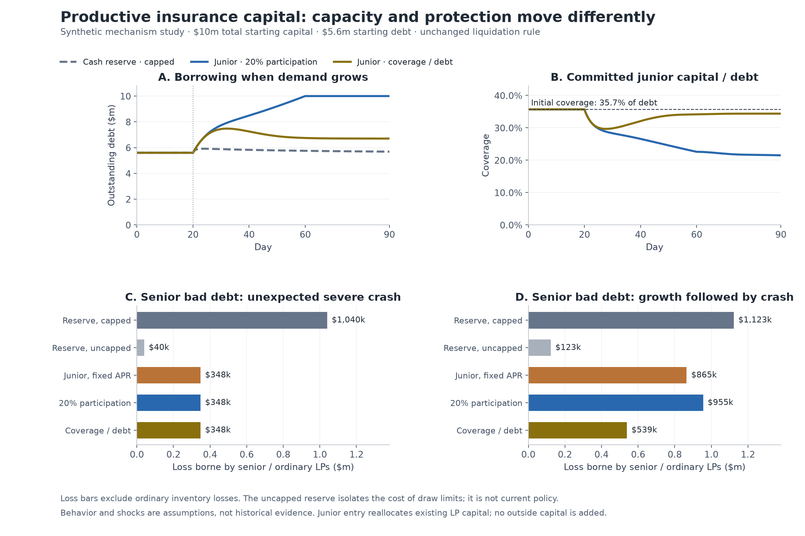

# Productive junior capital and autonomous risk pricing

**Current specification:** [PLAN.md](PLAN.md) and [V1 controller configuration](v1-controller/README.md).
The experiment below records earlier alternatives and assumptions. Include the
research with the implementation PR; follow [the packaging and cleanup checklist](PR-CHECKLIST.md).

**Provisional direction: price committed junior capital against covered exposure;
do not use the junior fraction of total LP equity as the sole risk signal.**
Deploying junior capital increases active backing but makes protection vulnerable
to the same inventory shock that can cause bad debt. The experiment does not
identify an optimal coverage ratio, a sustainable market-clearing APR, or a
production-ready replacement for Dusk's insurance.

This is a **synthetic economic simulation**, not a historical backtest or native
Dusk/hLP replay. That initial study changed no protocol or SDK files. The subsequent native
implementation is documented separately in [IMPLEMENTATION.md](IMPLEMENTATION.md).
The study outputs remain here with their original assumptions.



## The user's design objective

Improve both capital efficiency and LP bad-debt coverage while retaining V2's
borrower-facing liquidation rule. V1 liquidation checks use AMM impact-adjusted
collateral proceeds. V2's public-borrow liquidation check uses linear collateral
valuation and the position's liquidation CF. The simulation keeps one common
fixed trigger and varies loss funding and pricing; it does not restore a
depth-dependent trigger or silently change leverage limits.

The scope is default senior LP claims plus an opt-in junior layer. A cash exit
or switch from junior to senior requires a notice period and remains liable for
losses until execution. Ordinary inventory P&L is shared pro rata; only realized
credit shortfalls follow the junior-first waterfall. This is limited bad-debt
protection, not a guarantee of LP principal against token price changes.

## Fair starting comparison

Every policy starts with $10m total economic capital, $5.6m debt and 8% APR.

| Policy | Active pool equity | Segregated reserve | Price signal |
|---|---:|---:|---|
| Reserve, capped | $8m | $2m | Dusk-style utilization controller |
| Reserve, uncapped | $8m | $2m | Same controller; draw-cap ablation |
| Junior, fixed APR | $10m, including $2m junior | $0 | Fixed 8% |
| Junior, participation | $10m, including $2m junior | $0 | Committed junior / active equity; target 20% |
| Junior, coverage/debt | $10m, including $2m junior | $0 | Committed junior / debt; target 35.714% |

**Dusk does not require a 20% segregated insurance reserve.** That $2m endowment
is a hypothetical matched-budget comparator. The reserve is treated as
permanent protocol-owned debt-asset cash, not callable private underwriting.
The junior layer is callable after notice and earns half of realized interest.
Those different capital contracts are explicit, not assumed equally fundable.

Moving from $8m to $10m active backing is a 25% increase in active backing at
equal total capital. It is not a measured 25% improvement in AMM depth, trading
volume or borrower capacity. Some active backing is already lent out. Cash,
active equity, and debt are tracked separately.

## What the base assumptions show

### Growth without a crash

| Policy | Average debt / initial capital | Debt-weighted paid APR |
|---|---:|---:|
| Reserve, capped or uncapped | 57.4% | 10.84% |
| Junior, fixed APR | 75.6% | 8.00% |
| Junior, participation | 82.9% | 6.83% |
| Junior, coverage/debt | 66.0% | 9.33% |

Participation pricing allows rising loan income to attract senior-to-junior
reallocation. With the junior share above target, it lowers APR even while
debt grows. By day 90 all $10m of active backing is lent out. Junior/debt coverage
has deteriorated despite the junior participation ratio staying near 20%.
The debt-denominated controller sees that exposure growth and prices it upward.

In the calm scenario all policies fund the same $5.6m debt: deploying more
backing does not create borrower demand. The extra $9,863 of 90-day tranche-pool
income comes entirely from the assumed 2% swap return on the extra $2m, not
from observed trading activity or additional interest.

### Senior credit losses; ordinary inventory losses excluded

| Scenario | Capped reserve | Uncapped reserve | Fixed junior APR | Participation target | Coverage/debt target |
|---|---:|---:|---:|---:|---:|
| Unexpected severe crash | $1,040,000 | $40,000 | $348,000 | $348,000 | $348,000 |
| Growth followed by severe crash | $1,122,765 | $122,765 | $865,209 | $955,257 | $538,844 |
| Repeated crashes | $1,126,608 | $446,608 | $233,235 | $169,718 | $240,243 |

In the unexpected severe crash every arm has the same $5.6m debt and $2.04m
principal shortfall. Tranching does not prevent that loss. The junior pool first
loses $308,000 of junior equity to its share of inventory decline, leaving
$1.692m to protect senior. The capped reserve pays only $1m because its daily
limit binds; the uncapped reserve pays the full $2m. Thus the apparent advantage
over capped insurance includes the effect of more permissive loss allocation.

After growth, coverage/debt pricing reduces senior bad debt by $416,413 (43.6%)
versus participation pricing in the base case. Debt immediately before the
shock is $7.25m rather than $8.49m. Most of the protection improvement is
explained by lower exposure, not by more loss-absorbing capital at settlement.
This is a capital-efficiency/risk trade-off, not a free improvement in both.

The repeated-crash result is deliberately retained: coverage/debt has worse
senior losses than participation in 15 of 18 settings. The participation arm
often restrains borrowing more aggressively after depletion. The debt signal
is therefore a better exposure denominator, not a universally superior policy
under arbitrary controller and response parameters.

### Junior exit requests

In the base run-before-crash scenario, participation and coverage/debt have no
senior credit loss. Average debt is respectively 35.5% and 43.5% of initial
capital; paid APR is 13.27% and 10.02%. The participation target suppresses
borrowing more strongly even as reducing debt improves actual coverage.
Exit requests are paid at settlement-time NAV after intervening losses. Junior
conversions use claims; cash exits also require available liquid inventory.

No external junior deposits are modeled. All new junior capital is existing
senior LP equity voluntarily reassigned to junior. Post-loss recapitalization is
therefore a new allocation decision by remaining LPs, not free recovery of the
original junior holders or fresh system capital. Frozen-allocation sensitivity
shows that a controller can restore coverage principally by reducing debt.

## Sensitivity, verification and interpretation limits

The full grid contains **630 runs**: five policies, seven scenarios and 18
parameter settings. Another **70 runs** compare three-hour and one-hour time
steps with the base six-hour step. Borrower elasticity, LP allocation speed,
junior revenue share, exit notice, controller speed, inventory drawdown and
repayment speed are varied, including two interaction corners. The seventh
scenario was added after the initial run; its rationale is recorded in
[PREANALYSIS.md](PREANALYSIS.md).

Coverage/debt has lower senior credit loss in all 18 growth-then-crash settings,
but often funds less debt. This is an assumption-grid result, not an estimated
probability, confidence interval, or proof of real-market superiority.

Twelve targeted tests pass. The independent CSV verifier checks 113,575 balance
and flow identities across all 35 base traces; maximum residual is below
$0.000001. Numerical step sensitivity reaches $6,522 in senior loss, 0.411
percentage points in average debt/initial capital, and 0.093 percentage points
in paid APR. Those checks establish internal accounting, not financial realism.

Material limits:

- One debt numeraire with liquid inventory assumed convertible at marked value.
  No actual two-token settlement, internal AMM price impact, hLP funding,
  concentrated-liquidity shape, oracle lags or integer math is executed.
- Debt demand and underwriting preferences are invented sensitivity assumptions.
  The calm 20% junior equilibrium is a modeling assumption, not a discovery.
- Shocks have no assigned frequencies. Large scenario losses cannot be compared
  with annual income as if they occurred annually or used to infer fair premiums.
- Interest is fully cash-paid each step. Higher rates do not capitalize into
  debt or force rate-driven insolvency here; real Dusk debt can behave differently.
  Repayments also assume outside borrower resources. Both limits are optimistic.
- Inventory drawdown, collateral recovery, defaulted share and execution discount
  are exogenous stress inputs. They do not emerge from a native liquidation
  simulation. Normal liquidation insurance funding, protocol fees, market
  competition and incentives are omitted. Total economic P&L includes inventory
  losses and can rank arms differently from senior credit protection.

## Reproduce

From this directory, core simulation and checks use only the Python standard library:

```sh
python3 -m unittest test_model.py -v
python3 run.py
python3 verify.py
../competitive-pilot/.venv/bin/python analyze.py
```

`analyze.py` uses the existing repository research environment's Matplotlib.
No dependencies were installed. [config.json](config.json) and
[run.py](run.py) declare every input and sensitivity. [model.py](model.py)
contains accounting and behavior. [results/summary.csv](results/summary.csv),
[results/events.csv](results/events.csv), and [results/traces/](results/traces/)
retain outcomes, loss events and all base paths. [Paired comparisons](results/paired_comparisons.csv)
and [step checks](results/step_sensitivity.csv) preserve adverse results too.

## Source anchors

- V1: `../omnipair-rs/programs/omnipair/src/instructions/lending/liquidate.rs`,
  impact-adjusted collateral value and liquidation check (around lines 207–227).
- V2: `programs/dusk/src/transitions/lending/mod.rs`, linear collateral value
  in `is_position_liquidatable_with_risk` (around lines 414–442).
- `programs/dusk/src/math/risk.rs`: utilization error, curve and adapting anchor.
- `programs/dusk/src/state/market.rs`: 70% default target utilization, curve
  steepness 4 and adaptation speed 20/year.
- `programs/dusk/src/constants.rs` and `transitions/ledger.rs`: 20% per-event,
  50% per-day insurance limits and available-token accounting.

[results/manifest.json](results/manifest.json) records working-tree hashes,
repository HEAD and runtime. This working tree already contained unrelated
changes, so the source hashes are the controlling provenance.

## What this supports doing next

Specify protection as an explicit loss-bearing claim on committed junior NAV,
separate from the debt-token cash needed for settlement. Use coverage per
exposure as the pricing input, with a defined commitment horizon. Evaluate a
small cash buffer plus junior LP backing in the actual two-asset and hLP engine
before selecting a capital split. That hybrid is a research candidate, not a
result tested or optimized here. Preserve the borrower trigger and charge for
residual execution risk through underwriting rather than liquidity-dependent
liquidation eligibility.
