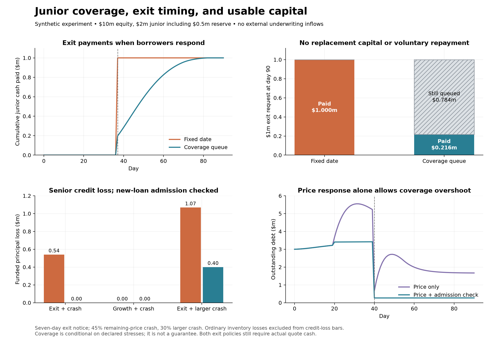

# Hybrid underwriting model: what is established and what remains a choice

**A consistent candidate has three separate controls: a first-loss capital
budget, a price for underwriting, and actual token liquidity. A junior/senior
participation ratio cannot substitute for all three.** This iteration makes the
exit trade-off explicit; neither a finite exit date nor permanent minimum
coverage can be promised simultaneously without replacement capital, a callable
loan contract, or another funded loss bearer.

The model is synthetic and scenario based. It is not calibrated, optimal,
audited, or integrated into the Dusk program. Its calculations are useful for
rejecting inconsistent mechanisms, not proving real-market safety. No runtime
code, SDK interfaces, product scope, branches or commits were changed.



## What Monolith and Liquity actually do

| Protocol | Exit/change rule | Backstop and limits |
|---|---|---|
| Monolith | Borrowers can switch free/redeemable and paid/nonredeemable debt at any time. The staking Vault also has ordinary ERC-4626 withdraw/redeem overrides that accrue interest; no coverage-ratio queue appears in those methods. | This is not a junior insurance vault. Redemptions retire eligible free debt; severe bad debt is socialized over remaining borrowers. Switching to paid does not exempt a borrower from solvency rules or bad-debt redistribution. |
| Liquity V1 | No minimum lockup, but principal withdrawals pause while unliquidated Troves below 110% collateralization exist. | The Stability Pool burns LUSD against liquidated debt and receives collateral. If depleted, debt and collateral redistribute to other borrowers. The pause is not a guarantee that a target pool/debt ratio remains funded. |
| Liquity V2 | Official docs say no lockup. Current repository `withdrawFromSP` has no V1 pending-liquidation check; it requires at least 1 BOLD remain pool-wide. | Each branch has a Stability Pool. It receives 75% of borrowing interest revenue and liquidation collateral. Redemptions split according to absolute outside debt, `max(branch debt - SP deposits, 0)`, not a minimum-coverage withdrawal covenant. JIT liquidation and redistribution are fallbacks. |

Sources checked 2026-10-30: [Monolith modes](https://docs.monolith.market/protocol/paid-vs-free-debt),
[Vault code](https://github.com/MonolithMarket/Monolith/blob/main/src/Vault.sol),
[Lender code](https://github.com/MonolithMarket/Monolith/blob/main/src/Lender.sol),
[Monolith bad debt](https://docs.monolith.market/protocol/bad-debt-socialization),
[Liquity V1 exits](https://docs.liquity.org/liquity-v1/faq/stability-pool-and-liquidations),
[Liquity V2 Earn](https://docs.liquity.org/v2-faq/bold-and-earn),
[Liquity V2 redemptions](https://docs.liquity.org/v2-faq/redemptions-and-delegation),
[Liquity V2 liquidation fallbacks](https://docs.liquity.org/v2-faq/borrowing-and-liquidations),
[V2 withdrawal code](https://github.com/liquity/bold/blob/main/contracts/src/StabilityPool.sol#L286-L319),
[V2 interest minting](https://github.com/liquity/bold/blob/main/contracts/src/ActivePool.sol#L243-L265).
Repository inspection is not verification of deployed bytecode.

Both stablecoin systems can distribute newly issued native debt tokens against
accrued borrower interest. Dusk cannot mint an external borrowed asset such as
USDC or SOL. Its current ledger recognizes cash-backed realized interest; copying
the stablecoin yield mechanism would overstate cash available to underwriters.
Neither Monolith nor Liquity is an exact template for productive LP tranches.

## Accounting that the design needs

Let S be senior claim value, J total junior claim value, R segregated junior
reserve, C executable pool cash, X marked pool inventory, and P funded principal:

```
C + X + P = S + J - R
total funded equity = S + J
```

R is included in J. Future premiums, accrued unpaid interest, unowned borrower
collateral and gross hLP positions are not additional junior capital. Collateral
affects recoveries. hLP must be consolidated with its own funding liabilities;
its gross yLP holding cannot be counted as independent insurance.

When bad debt L is realized, actual matching-token reserve can cover a portion,
then junior LP claims absorb the remainder, then senior. The total junior loss
is at most J and is counted once. Burning or transferring junior claims need not
produce new cash. It reallocates an existing loss. Cash retention serves trading,
funding, redemption and execution needs separately.

At a common, manipulation-resistant valuation snapshot, if pool NAV before the
credit loss is A and supply N, burning `L*N/A` junior shares preserves remaining
non-junior NAV per share, provided junior owns enough shares. It preserves scalar
NAV only: a loss of quote tokens changes each surviving claim's token mix.
Example: 100 base + 100 quote, both worth 1, 200 shares. Losing 50 quote and
burning 50 junior shares leaves a 100-share senior holder with 66.67 base + 33.33
quote, still worth 100. That is not the original 50/50 token entitlement.

This algebra is not a ready patch for Dusk. Its per-side reserve/supply accounting,
curve rebasing, hLP funding, yield indexes, rounding and protected assets must
all consume the same settled loss exactly once. Relevant current paths are
`transitions/lending/liquidation.rs`, `transitions/leverage.rs`, and the terminal
hLP waterfall in `transitions/liquidity/hlp/engine.rs`.

## Price underwriting against stressed exposure

For each declared joint stress s, compute realizable collateral recoveries and
funded credit loss L_s, and mark junior's LP backing under the SAME stress to
obtain K_s. Check `K_s >= margin * L_s` across the envelope. Do not independently
promise the same junior dollar against base and quote losses that can coincide.
Forward capacity excludes capital requested for exit; actual queued shares
remain exposed to losses until settlement. Liquidity and liability horizons
must be included in a calibrated envelope, especially interest accrued while a
loan remains open and collateral liquidation is delayed.

The controller should move the **underwriting premium** with shortage of
committed stress capital. A funding component pays for supplied assets. New
loans and junior exits must be evaluated against their post-action books if the
product promises to preserve a coverage floor. A shortage does not change the
liquidation threshold of an existing position. It can change its variable rate,
which itself grows debt and can eventually cross that same threshold.

The simulation assumes 4% funding plus an adaptive premium starting at 4%,
bounded at 0.1–25%. All collected premium goes to junior; funding income follows
active LP ownership. These are illustrative contracts, not discovered clearing
prices. Underwriter participation reveals willingness to bear risk at the
offered terms; it is not an identified probability of default. Stress scenarios,
execution assumptions and demand responses still need independent calibration.

An APR cap also needs a defined shortfall state: restrict new uncovered exposure,
keep repayments available, continue agreed liquidation rules, and apply the
disclosed waterfall. A rate controller cannot manufacture capital or compel
repayment of a perpetual loan. An admission check prevents additional exposure;
it does not repair an already insufficient book or stop interest from accruing.

## Exit contracts: the unresolved product choice

**Finite notice:** junior can leave at the stated date and current NAV if the
required cash is available, even if coverage declines. Exclude pending capital
from new-risk capacity immediately, raise the premium within bounds, and allow
the remaining senior tail loss if capital does not return. Senior receives
first-loss subordination up to available J, not a permanent coverage floor.

**Coverage queue:** after notice, redeem only the amount leaving the remaining
book within the agreed stress budget. Pending shares still earn contractual
income and bear losses. This supports stronger coverage but can hold capital
indefinitely. A transferable junior receipt can let another investor take over
the exposure; it cannot guarantee a buyer, par value or a protocol cash exit.
Replacement underwriting must be funded before the old commitment is released.

Neither rule is universally correct. For a liquid, best-effort first-loss product,
finite notice is a coherent choice. For a contractual minimum-coverage promise,
the coverage queue or genuinely matched loan maturities is necessary. The user
has asked how Monolith/Liquity handle this and has not selected the promise.
No runtime exit policy was selected or implemented here.

## What the second experiment shows

Matched $10m equity, $2m junior including $0.5m reserve, $3m initial quote debt.
All loans use the same 70% origination / 85% liquidation LTV. The in-envelope
crash leaves base price at 45% of its initial value with 20% execution discount.
Ordinary inventory loss is separate from senior credit loss below.

| Comparison | Finite notice | Coverage queue |
|---|---:|---:|
| $1m requested exit, no repayment/replacement: cash paid by day 90 | $1,000,000 | $215,700 |
| Same case: still queued at day 90 | $0 | $784,300 |
| Exit followed by in-envelope crash: senior credit loss | $540,165 | $0 |
| Same crash: total cash paid to exiting junior, including post-loss payout | $1,000,000 | $316,606 |
| Exit followed by out-of-envelope crash to 30% price: senior credit loss | $1,067,943 | $399,657 |

In the queue, junior's lower payout is partly the price of actually absorbing
the intervening loss, not just a temporary payment delay. In the no-repayment
case both policies hit 29% quoted APR, but collect zero cash interest. Higher
quoted yield cannot be counted as cash available to attract/repay junior.

In the growth-then-crash base case, **price only** produces $729,482 senior
credit loss; adding the post-loan admission check produces $0. That benefit
comes with less debt: average debt over the scenario is $2.89m vs $1.56m,
including slower borrowing after the crash. It is not free capital efficiency.

Across 44 parameter/reserve combinations with both coverage exits and checked
admission, the exit-then-in-envelope-crash has no senior credit loss. Four
growth-then-crash cases still lose $12,883–$13,351 when the margin is exactly
1.00: unpaid interest grows after admission. All 44 out-of-envelope crash cases
lose senior capital ($61,669–$606,746). These are deterministic stress cases,
not frequencies or probabilities. A buffer buys tolerance; it does not prove a
guarantee against unknown shocks or unlimited time.

The supplemental 36-case base/quote book shows why the reserve currency matters.
With $5m total exposure in each asset and all debt in quote, $1m quote reserve
supports $3.17m stress-feasible debt; $1m base reserve supports $2.26m. With all
debt in base, the direction reverses. At $2m quote reserve, quote-lending capacity
falls to $3m because segregated funds leave only $3m quote pool cash. Those
numbers are results of declared shocks, not a recommendation for $1m reserves.

## Default senior versus optional protection

Default senior plus opt-in junior gives one covered non-junior pool. Fee allocation
must charge every protected class consistently, including any eligible net hLP
exposure. This is the simpler accounting target for further integration work.

Optional senior protection is possible, but core-level junior share burning
would also benefit unwrapped ordinary LPs. A wrapper must perform the transfer
inside its own covered book, or protocol accounting must distinguish covered
and uncovered claims. Otherwise unwrapped LPs receive unpaid protection.
Calling an intermediate loss layer “pass-through” does not remove its contract:
if it loses after junior but before senior, it is a mezzanine tranche and needs
its own loss and premium rules. No third layer is required for this experiment.

## Validation and reproduction

The grid has 1,056 dynamic runs (11 settings × 4 reserve allocations × 2 exit
contracts × 2 admission policies × 6 scenarios), 24 six-hour reruns, and 36
static directional cases. Eighteen tests pass, including randomized loss
conservation. The independent CSV checker reconciles 81,552 identities across
96 base traces; maximum residual is below 0.000001 dollars/shares.

One-day versus six-hour step differences reach $14,572 senior loss, $12,995
exit payments, 0.493 percentage points average debt/initial capital, and 0.079
percentage points quoted APR. Numerical precision is not economic calibration.

```
python3 -m unittest test_model.py -v
python3 run.py
python3 verify.py
python3 two_asset.py
../../competitive-pilot/.venv/bin/python analyze.py
```

Inputs and event ordering: [PREANALYSIS.md](PREANALYSIS.md), [model.py](model.py),
[runner/settings](run.py), [parameters](results/parameters.json).
Inspect [all outcomes](results/summary.csv), [exit comparisons](results/exit_comparisons.csv),
[directional cases](results/two_asset_capacity.csv), [step differences](results/step_sensitivity.csv),
[verification](results/verification.json), [tests](results/tests.log).

Remaining evidence required before implementation is called validated: execute
native Dusk base/quote and hLP settlement paths against this accounting contract;
test manipulable pricing, concurrent exits, transfer fees and rounding; calibrate
liquidation delays/recovery under market depth shocks; measure underwriting and
borrower demand. Current synthetic inventory is held, not traded through the
AMM; recovery discounts and outside repayment resources are assumed. This study
does not establish an optimal reserve size, premium, notice period or leverage
limit. Those cannot be identified from protocol analogies and invented demand.
