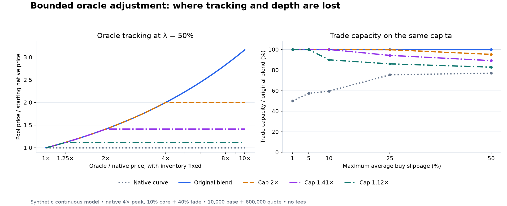

# Bounded oracle adjustment: tracking, trade capacity, exit loans and hLP

> Archived research, 27 October 2026. Statements below about authorization and the unmerged baseline describe that date. PR #45 merged on 29 October; see [the current plan](OP_GAMM_PLAN.md) for implementation status. Numerical results retain their original assumptions and limitations.

27 October 2026. **Research only. No Dusk implementation, source-code changes, commits, merges or PRs.** Integration remains deferred until #45 merges and is authorized. Numerical calculations ran in memory; saved artifacts are results, assumptions, figures and design notes.

**Result:** a bounded correction retains the original blend exactly while the bound is inactive, and restores the native tail's infinite-volume boundary in the continuous model. With λ = 50% and a maximum 2× price adjustment, the concentrated fixture loses effectively no trade capacity at the tested 1%, 5% and 10% average-slippage limits. The same cap at λ = 90% loses 15.1% and 25.2% of capacity at 5% and 10% slippage. The cap reduces responsiveness to extreme valid price changes and limits, but does not eliminate, losses from accepted false reports.

The tested lending and clean hLP identities remain consistent. This is not a native-runtime equivalence claim or a proof against all oracle/governance attacks. The full receivable/frozen-hLP endpoint remains unresolved.

## Model and comparison

Let N be the current native marginal price, O the accepted oracle price, and M > 1 the maximum multiplicative price adjustment. Use the same units for N and O:

```text
Native:          P = N
Original blend:  P = N × exp[λ log(O/N)]
Bounded blend:   P = N × exp[clip(λ log(O/N), −log M, +log M)]
λ = 0:          P = N directly, without reading O
```

The main example uses M = 2 and λ = 0.5: P/N stays between 0.5 and 2. The cap starts binding when O/N leaves [1/4, 4]. A 2× maximum adjustment is not a universal recommended setting, and λ = 50% is not a selected deployment default.

The initial sensitivity sweep parametrizes the same function using a mismatch threshold T:

```text
P = N × exp[λ clip(log(O/N), −log T, +log T)]
M = T^λ; equivalently T = M^(1/λ) when λ > 0.
```

The T sweep uses 1.25, 2 and 4 at λ = 0.25, 0.5, 0.75 and 0.9, plus native controls. Holding T fixed changes M when λ changes. A separate fixed-M = 2 sweep prevents conflating those policies. At λ = 50%, T = 1.25/2/4 corresponds to maximum adjustments of approximately 1.118×/1.414×/2×.

All trades integrate the marginal price through the conditional invariant from the [coupled model](OP_GAMM_COUPLED_MODEL.md). Neither the old swap output nor the final execution price is clipped after the trade. The [paper's boundary-divergence condition](https://arxiv.org/html/2609.33799v1) is the relevant structural requirement; this bounded construction is our extension, not a claimed prescription from the paper.

**Why the boundary is restored:** N/M <= P <= MN. In either extreme tail, the native normalized price is asymptotically proportional to the reserve ratio. The bounded price therefore remains comparable to that ratio. The conditional-invariant integrals diverge logarithmically at both inventory boundaries, requiring infinite cumulative input to empty a reserve. This is a real-number, fixed-geometry statement. Finite token atoms, cash availability, public debt and integer settlement still need explicit runtime checks.

Hard clipping creates a derivative kink. Price stays continuous and monotone; the paper's global continuous-differentiability premise is not literally satisfied at the kink. A numerical contract or a bounded smooth transition must be specified before implementation. Smooth saturation was not tested here.

## Source baseline and fixtures

Native formulas are pinned to #45 commit `77877d576018fd2bd8191d13f05534b0484e2282`: [concentration](https://github.com/omnipair/dusk/blob/77877d576018fd2bd8191d13f05534b0484e2282/programs/dusk/src/transitions/amm/curve.rs), [credit and health](https://github.com/omnipair/dusk/blob/77877d576018fd2bd8191d13f05534b0484e2282/programs/dusk/src/transitions/lending/mod.rs), and [hLP accounting](https://github.com/omnipair/dusk/blob/77877d576018fd2bd8191d13f05534b0484e2282/programs/dusk/src/transitions/liquidity/hlp/integrated.rs). These are source-derived continuous models, not calls to the Rust/SVM program or a claim about the latest remote head.

The two shapes are a plain CPMM and Dusk's nested concentration geometry with **4× peak amplification, 1,000 bps core half-width and 4,000 bps fade**. Ordinary inventory starts at 10,000 base and 600,000 quote, center/reference 60. Marked starting capital is 1,200,000 quote. Shape and center remain frozen; fees are zero.

For the concentrated fixture, derive liquidity shares from the source formula. With a = sqrt(1.1), b = sqrt(1.5), the concentrated share is (1−1/4)/[(1/a+1/b)/2]. Total active liquidity is 4 sqrt(xy); the tail share is about 15.2523% of active liquidity, giving tail liquidity 47,257.468437. Core and shoulder split the concentrated liquidity equally in real numbers. This is actual 4× **peak amplification**, unlike the earlier illustrative four-times-active-tail fixture.

Credit uses only recognized tail liquidity, max collateral factor 0.85, buffer 0.05, a **research market-health floor of 110%**, and the source's 150% contribution-cap structure. The health floor is a chosen test profile, not asserted to be every market's default. Sensitivity cases also use 100% and 125%. Effective existing debt, per-position contribution caps, projected market health and actual modeled cash are included. Native atom rounding, daily buckets and full transaction validation are excluded; repeated-fault scenarios allow enough elapsed time between episodes. Favorable admission filters are assumed settled; own-pool tests deliberately allow the post-trade price without an additional favorable-EMA delay. Recognized tail depth cannot grow above its starting/preceding value during the relevant trade/loss path.

## Oracle tracking and capital efficiency

Inside the cap, price, oracle responsiveness and trade path are identical to the original blend. Outside it, the instantaneous oracle response is zero until inventory or the reference brings the ratio back inside. This is a limit on reference influence, not an outage fallback: invalid feeds still follow the separately specified failure policy.

With fixed inventory, λ = 50%, N = 60:

| Accepted oracle O | Native quote | Original blend | Bounded, M = 2 |
| --- | ---: | ---: | ---: |
| 72 | 60.00 | 65.73 | 65.73 |
| 90 | 60.00 | 73.48 | 73.48 |
| 240 | 60.00 | 120.00 | 120.00 |
| 480 | 60.00 | 169.71 | 120.00 |

At an 8× move, the bounded quote is 29.3% below the original blend's quote. It incorporates one-third of the oracle's log move, versus one-half for the original blend. Neither quote fully follows the new oracle at fixed inventory. The downside is reciprocal: the cap can also stop the pool following a genuine crash far enough.

Here **capital efficiency means buy notional executable within an average-slippage limit on identical starting capital**. It does not mean lending LTV, maximum recursive leverage, LP return or withdrawal cash. Notional is acquired base valued at the initial reference of 60; average slippage is trade cost/base amount divided by 60, minus one.

| Average buy-slippage limit | Native Dusk geometry | Original blend, λ = 50% | M = 2, λ = 50% | Capacity lost versus blend |
| --- | ---: | ---: | ---: | ---: |
| 1% | 23,762 | 47,517 | 47,517 | 0% within numerical tolerance |
| 5% | 114,242 | 199,166 | 199,166 | 0% within numerical tolerance |
| 10% | 191,921 | 322,744 | 322,744 | 0% within numerical tolerance |
| 25% | 336,440 | 446,298 | 445,438 | 0.19% |
| 50% | 408,912 | 530,976 | 505,861 | 4.73% |

At the 5% limit, the bounded candidate still supports 74.3% more notional than native geometry in this fixture. These are conditional capacities, not predicted customer volumes. The large slippage limits deliberately probe extreme inventory states.

Keeping the **same M = 2** while increasing λ to 90% changes the result: capacity falls from 483,668 to 410,714 at 5% slippage (**15.1% lower**) and from 591,005 to 442,277 at 10% (**25.2% lower**). There is no universal negligible-cost claim.

At balance, infinitesimal depth is multiplied by 1/(1−λ) versus native for both blends. Just across a cap boundary, price is continuous but inventory sensitivity returns to its native value. At that same boundary state, local depth falls to (1−λ) of the uncapped blend's depth: a 50% drop at λ = 50%. Local marginal depth and total trade capacity are different measures; the former need not imply the same percentage loss in the whole trade.



## Correct price jumps and accepted false reports have opposite tradeoffs

For a **correct** sudden oracle/true-price move from 60 to 480, followed by fee-free arbitrage to the true price:

| Model, λ = 50% when applicable | Arbitrage transfer versus holding initial inventory at the new price |
| --- | ---: |
| Native | 2,817,140 |
| Original blend | 1,560,278 |
| Bounded, M = 2 | 1,829,628 |

The cap increases that transfer by **17.3% versus the original blend**. The new marked starting inventory is 5,400,000, so these are foregone marked gains relative to holding, not a claim that more than the initial cash balance was withdrawn. This deliberately extreme valid jump shows the cost of rejecting part of a real signal. With a correct 1.5× move, M = 2 does not bind and the paths agree.

For an **incorrect** accepted report of 600 while the outside price stays 60, the cap limits overpricing. In ten loan/default/recovery cycles with optimized single-loan size, cash carried forward, collateral sold outside at 60 and honest-reference arbitrage between episodes:

| Model, λ = 50% when applicable | Modeled LP loss over ten cycles |
| --- | ---: |
| Native, unused oracle | 0 for this oracle-only attack |
| Original blend | 555,822 |
| Bounded, M = 2 | 177,055 |
| Bounded, M ≈ 1.414 | 14,422 |
| Bounded, M ≈ 1.118 | 0 for these selected loan sizes/states |

The M = 2 loss is 68.1% lower than the original blend, but remains large. With the smaller incorrect report of 100, M = 2 does not bind: both lose about 1,422 over ten cycles. Tighter caps also impede correct tracking; the approximately 1.118× cap reduces the quote for a genuine 1.5× move from 73.48 to 67.08.

These are synthetic accepted-report stresses. They assume no provider-compromise costs, acquisition fees or outside market impact, immediate modeled default recovery and sufficient time between faults for admission/limits. They do not estimate real attack likelihood or recommend a cap. Baseline native has no dependence on the faulty feed, but still has its own reserve-manipulation and stale-market risks.

## Exit-loan checks

The comparison uses the source-derived credit operator, rather than forcing debt to be less than the trade proceeds by construction. It includes projected global health and effective existing debt. The results are:

| Check | Outcome |
| --- | --- |
| 272 base-collateral own-pool purchase/borrow cases | No positive acquisition-to-borrow profit. |
| 170 reciprocal quote-collateral cases | No positive acquisition-to-borrow profit. |
| 612 own-pool cases splitting the purchased collateral across 2, 10 or 80 positions | No positive total borrow minus acquisition cost. |
| 50 additional fixed-M = 2 own-pool cases | No positive acquisition-to-borrow profit. |
| 816 split-loan scenarios, examining all 1–80 position prefixes (65,280 states) | No aggregate loan payout above the direct sale of the same total collateral. |

The prefix sweep varies shape, λ, cap, oracle/native ratio 1, 1.6667, 4 and 10, and collateral per position of 1, 10, 50, 100, 500 and 1,000 base. A favorable false report can still make borrowing profitable against the outside price; the comparison distinguishes that common mispricing from an additional lending exit.

**Validation correction:** an exploratory calculation that omitted the projected market-health floor appeared to permit an extra aggregate exit. Adding the actual admission floor removed that result in the tested profiles. Four representative sequential-loan cases were independently recomputed using 55-digit Decimal arithmetic; they agree to less than 0.000002 quote with the main calculations. Health-floor sensitivity at 100%, 110% and 125% also preserves the loan-versus-sale inequality in the selected cases. The omitted-guard result is not a Dusk finding.

These finite tests do not establish a global theorem for every configuration. Dynamic fees, lambda/governance transitions, stale-history transitions, collateral-release paths and native integer execution are not certified here. The older gross-versus-net fee caveat remains relevant.

## hLP and the zero limit

Across 340 endpoints covering both swap directions plus 50 additional fixed-M = 2 endpoints, clean hLP target equities, opposite-token hedge matching and live/cash accounting reconcile. Maximum relative residual is 4.25×10^-16 in floating-point arithmetic. This confirms the ownership algebra for these endpoints, not every endpoint's admissibility under native funding limits.

The cap changes the endpoint and thus gross internal funding. In the extreme 90%-of-base purchase, with 1,000 base-target equity and 60,000 quote-target equity:

| Model, λ = 50% when applicable | Base-hLP quote debt after trade |
| --- | ---: |
| Native | 2,745,410 |
| Original blend | 1,432,903 |
| Bounded, M = 2 | 1,601,383 |

The bounded debt is 11.8% above the original blend in that stress. At an identical funding rate and duration, that leg's funding accrual rises proportionally. Both target equities remain unchanged during the clean fee-free trade; this is not a net-return forecast. Funding rates, caps, accrued public interest, frozen vaults and ordinary LP transfers need the full coupled solver.

The idle test accrues 1% on an initial 60,000 quote hLP debt. The unpaid gap remains **600 quote in every mode** after an oracle-only update. Prices change its marked base value, not custody or the debt owed. Bounding the oracle adjustment does not provide idle hedge maintenance or pay funding.

At λ = 0, both candidates take the native branch with O absent. Forty native endpoint comparisons, including the concentrated bands and tails, agree with an independently reconstructed native inventory path within 1.14×10^-14 relative error. The hLP and credit expressions use the same native limit. Exact equality in integer instructions, account requirements and compute remains to be tested after integration is permitted.

## Reproduction and validation

The calculation follows the normalized X(u), Y(u) geometry in the coupled note. Let t = log u, r = Y/X, H = d(log r)/dt and p = P/C. Integrate H r/(r+p) in t to obtain G. Then x(t) = x_start exp[G(t_start)−G(t)] and y(t) = C x(t) r(t). Each grid interval is integrated using 12-point Gauss–Legendre quadrature, with explicit breaks at concentration boundaries and clip thresholds; inversion uses interpolation followed by Newton corrections. Native curves are independently recovered from their original inventory formula.

For a CPMM, capped regions have P = k y/x and therefore y x^k constant. The uncapped region has (O x)^λ + y^λ constant. Joining those segments supplies a separate analytic validator: **336 cases**, maximum absolute endpoint discrepancy divided by starting quote inventory **3.35×10^-12**. Another **102 reverse paths** recover the starting inventory within **7×10^-15** relative error.

The data bundle contains [assumptions and source hashes](../analysis/bounded-oracle-adjustment-2026-10-27/assumptions.json), [validation results](../analysis/bounded-oracle-adjustment-2026-10-27/validation.json), [trade capacities](../analysis/bounded-oracle-adjustment-2026-10-27/capacity.csv), [fixed-2× sensitivity](../analysis/bounded-oracle-adjustment-2026-10-27/fixed_2x_capacity.csv), [all split-prefix scenario summaries](../analysis/bounded-oracle-adjustment-2026-10-27/split_prefix_search.csv), [repeated loss cycles](../analysis/bounded-oracle-adjustment-2026-10-27/repeated_cycles.csv), and [hLP endpoints](../analysis/bounded-oracle-adjustment-2026-10-27/hlp.csv). The [manifest](../analysis/bounded-oracle-adjustment-2026-10-27/manifest.json) hashes saved evidence files. No historical data or borrower-demand estimate is implied.

**Next design input:** keep the bounded family as the candidate, specify the cap/kink numerical contract and complete the full receivable/frozen-hLP endpoint before implementation. Calibrating M and λ requires an asset/session-specific distribution of accepted feed errors, valid price jumps and actual inventory paths. These tests support the family; they do not select deployment parameters or change market scope.
