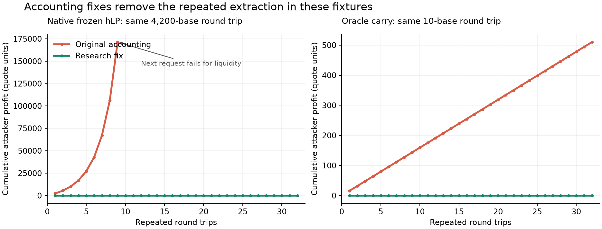

# Two isolated accounting failures and research fixes

> Archived research, 27 October 2026. Statements below about authorization and the unmerged baseline describe that date. PR #45 merged on 29 October; see [the current plan](OP_GAMM_PLAN.md) for implementation status. Numerical results retain their original assumptions and limitations.

27 October 2026. **Research only.** Pinned source: `77877d576018fd2bd8191d13f05534b0484e2282`, the #45 baseline used in the preceding study. This does not assert that the latest #45 head or merged main still has the native issue. No candidate was applied to the working `programs/` or SDK, and no branch, commit, merge or PR was created.

**Result:** both failures reproduce with a constant reference and two trades. Separate accounting corrections remove their repeated extraction in the tested cases. The native frozen-vault issue is independent of OP-GAMM. The carried-interest issue is in the research oracle model; it is not evidence that native Dusk's normal funding policy has that leak.

| Minimal round trip | Original accounting: attacker profit | Research fix: attacker profit |
| --- | ---: | ---: |
| Native, one base hLP frozen; sell and buy back 4,200 base | 37.592267408 base = **2,255.53604448 quote** | −13 base atoms = −0.00000078 quote |
| Bounded oracle model, funding carried; sell and buy back 10 base | 0.265622482 base = **15.93734892 quote** | −24 base atoms = −0.00000144 quote |

Both legs settle against one persistent market. There is no oracle change, borrower default, reset of inventory, or fresh liquidity between the two trades. Profit is a real token surplus; the quote conversion uses the unchanged external price of 60. Consolidated LP wealth falls by the same amount. Fees, gas, transfer fees and external execution costs are zero to expose the accounting effect.

## 1. Native frozen-hLP repro

Initialize through native transitions: 10,000 base + 600,000 quote of ordinary liquidity, then 1,000 base hLP and 60,000 quote hLP. Token decimals are 9/6. Use the previous 4× peak-amplification profile, 1,000 bps core half-width and 4,000 bps fade, centered at 60.

Multiply only the quote borrow index by three and call native `freeze_negative_hlp_vaults`. This is an explicit severe funding-index shock, not a claim that normal daily accrual triples debt. The base hLP is frozen; the quote hLP stays active. Market invariants pass. The frozen vault retains its shares, indexed debt, principal, funded reserve leg and offsets.

Execute via native `BenchmarkMarket::execute_swap_with_hlp`, including hLP custody-balance checks and measured funding-interest credits:

```text
Sell 4,200.000000000 base  →  227,895.883756 quote
Spend that entire output →    4,237.592267408 base
Profit                   →       37.592267408 base
```

The failure has two linked accounting causes:

1. `reconstructed_curve_point` treats a frozen vault's zero active equity and retained debt as an active negative-equity hedge, then applies frozen offsets as well. That counts the frozen leg twice.
2. Active hLP debt and ownership reconstruction omit the other frozen vault's funded reserve leg from the relevant denominator. The active vault can acquire excess ownership when the next swap reconstructs the market.

**Smallest tested correction:** ignore the frozen vault in the active-equity valuation and include its funded leg consistently in active hedge ratios and ownership denominators. Do not remove its actual shares or indexed debt. This is three localized arithmetic changes in the archived research source, shown in [candidate-accounting.patch](../analysis/op-gamm-stateful-2026-10-27/candidate-accounting.patch).

For example, with the base vault frozen and its funded quote leg `F_Q`, the active quote vault's ownership denominator is `B + F_Q`, not `B`, and its reconstructed base funding is `E_Q × A / (B + F_Q)`. Here `A,B` are ordinary **book** coordinates and `E_Q` is the active quote target equity. Retained unpaid funding, if present, needs its own terms described below. Frozen indexed debt is not substituted for the funded leg.

After this correction the same trades return 4,199.999999987 base. Repeating that exact 4,200-base round trip gives:

| Path | Repetition result |
| --- | --- |
| Original native accounting | 171,276.99759486 quote extracted over nine completed rounds; the tenth request fails for liquidity. |
| Research correction | All 32 rounds execute; cumulative attacker result is −0.00001668 quote. |

The symmetric quote-vault-frozen case also passes. Neither vault is automatically unfrozen, and no deficit is forgiven.

## 2. Oracle model carried-interest repro

Use the same market, but seed performing public debt equal to one-third of reserve cash on each side and accrue 432,000 slots using native interest arithmetic. Both hLP vaults remain active. Initial unpaid hLP funding is 0.073048 base and 4.382880 quote. Public interest remains a receivable, not spendable reserve cash.

Use `λ = 0.5`, maximum adjustment `M = 2`, reference 60. Explicitly retain the funding debt during the shadow swaps:

```text
Sell 10.000000000 base    → 607.892736 quote
Spend that entire output →  10.265622482 base
Profit                   →   0.265622482 base
```

Native Dusk normally pays this funding when cash permits; this forced-carry case isolates the research model's carry equations. A separate cash-constrained fixture tests retained funding when the reserve cannot fund it.

**Cause:** the model uses net hLP value as if it were the full backing claim, then subtracts retained funding again during ownership/debt reconstruction. Certifying the ordinary LP curve alone does not protect the hLP claim. The original model loses approximately 15.94 quote per round while leaving the funding debt unpaid.

**Smallest tested correction:** distinguish net value from the claim needed to cover retained funding, and include carry in both the hedge and ownership denominators. Let `c_B` be retained base funding owed by quote hLP, and `c_Q` retained quote funding owed by base hLP. For endpoint price `P_end`:

```text
base backing claim  = base net NAV  + c_Q / P_end
quote backing claim = quote net NAV + c_B × P_end
```

Reduce the corresponding ordinary book coordinates by the same added backing amounts; this preserves real non-debt inventory. The ownership denominators also include retained funding and, where applicable, the frozen funded legs. Debt remains indexed and outstanding until paid.

The backing correction and endpoint price must be solved together. Simply adding a premium or valuing the cover at a stale starting mark is not the same accounting rule. The prototype uses a bounded fixed-point iteration and rejects non-convergence.

Also anchor the trade certificate to both the actual starting inventory and the no-trade accounting-preparation endpoint. An internal ownership refresh cannot become a rebate for the next trader. A partial correction that omitted this second reference left an approximately 0.000099-quote first-round giveaway in this fixture; the final candidate removes it.

| Same 10-base round trip, 32 repetitions | Original model | Research correction |
| --- | ---: | ---: |
| Funding retained throughout | +510.07442664 quote | −0.00005646 quote |
| New accrual, with funding paid every fourth round | +82.77737970 quote | −0.00077340 quote |

In the corrected settlement/recovery path, the final quote funding balance is zero because 7.589706 quote was actually transferred to the interest vault over the run. In the continuously carried path, the original 4.382880 quote remains owed. Recovery does not reset the market or erase the obligation.

## Validation and limits

The full evidence is in [summary.json](../analysis/op-gamm-stateful-2026-10-27/results/summary.json), [minimal state traces](../analysis/op-gamm-stateful-2026-10-27/results/minimal_repros.json) and [repeated cycles](../analysis/op-gamm-stateful-2026-10-27/results/candidate_fix_cycles.csv).

- **96 configurations, 1,579 completed round-trip trials and 573 rejected trials:** CPMM and concentrated geometry; 9/6, 6/9, 2/2 and 0/0 decimals; clean, accrued, carried, one frozen and both frozen states. Attacker direction and size are selected from a finite grid, including raw-atom inputs. Rejected requests remain rejected; they are not counted as successful safe executions. These finite searches are not global optimization proofs.
- **192 repeated fixed-path round trips:** no positive attacker result, including actual accrual and periodic funding payment. The frozen tests retain their shares and indexed debt. Twenty-one additional cash-constrained carry round trips execute without positive profit; nine tiny or unavailable-output probes reject.
- **864 exact integer differentials** match the independent Python endpoint port to Rust under original and corrected switches. **564 regression comparisons** preserve unfrozen native outputs and verify that both blends at `λ = 0` use the native branch even with absent, zero or nonsensical oracle inputs. This is host-native ledger equality, not proof of equal on-chain accounts or compute costs.
- **168 indexed-repayment scenarios, 658 completed repayment steps:** aggregate debt reduction equals cash charged across every split prefix. No repeated rounding-based debt forgiveness occurs in those tests.
- **One separate rounding residue remains:** a 6/9-decimal, accrued-interest native CPMM case earns 48 quote atoms, or 0.000000048 quote, once. It is identical before and after the frozen correction; the next optimized cycle returns zero. This prevents a blanket claim that every native integer case is strictly non-profitable. Its trace is saved separately; it was not silently rounded to zero or repaired as part of these two fixes.



The native original curve ends at the last successful attack; the subsequent request fails. The fixed path continues through 32 completed rounds.

**Oracle risk remains separate.** In 240 additional corrected-model fault/recovery episodes, accepted false reports of 6 or 600 while the true external price stays 60 still cause large losses. For example, the accrued-interest fixture with competitive recovery loses 776,855 quote under the original blend and 695,896 under the bounded blend over eight episodes. That is accepted-price-error exposure, not the fixed constant-reference accounting loop. Weak recovery uses 10% of the input-size grid and no funded hLP recovery bidder. The native partial flash-recovery route is exercised as a diagnostic; terminal recovery and a complete OP-specific recovery policy are not implemented. Maximum consolidated cash/receivable reconciliation residual in these episodes is 4.66×10⁻¹⁰ quote. Public debt is assumed performing; that marked receivable is reported separately from cash.

These are synthetic accounting and adversarial stresses, not a historical backtest. The oracle solver still uses floating-point quadrature, a numerical certificate margin and host-native settlement. SVM execution, token-program CPIs, Token-2022 fees, governance transitions, exact-out, full terminal recovery, all hLP lifecycle paths, compute bounds and a formal fixed-point/rounding error proof remain outside this test. In particular, a production implementation must represent net NAV and backing claims separately rather than reuse a research field whose checkpoint semantics differ.

## Reproduce and next implementation input

[reproduce.py](../analysis/op-gamm-stateful-2026-10-27/reproduce.py) rebuilds the archived pin and runs both minimal repros with switches off/on. [README](../analysis/op-gamm-stateful-2026-10-27/README.md) gives the command and full-matrix option. Switches default off and exist only in the research copy. [Manifest](../analysis/op-gamm-stateful-2026-10-27/results/manifest.json) hashes the scripts and results.

The next implementation input is two separate reviewed changes: the native frozen reconstruction correction, and the OP model's explicit net-NAV/backing/carry contract. Recheck the native repro against the eventual merged #45 commit before preparing any Dusk patch. No Dusk integration or PR is authorized by this report.
